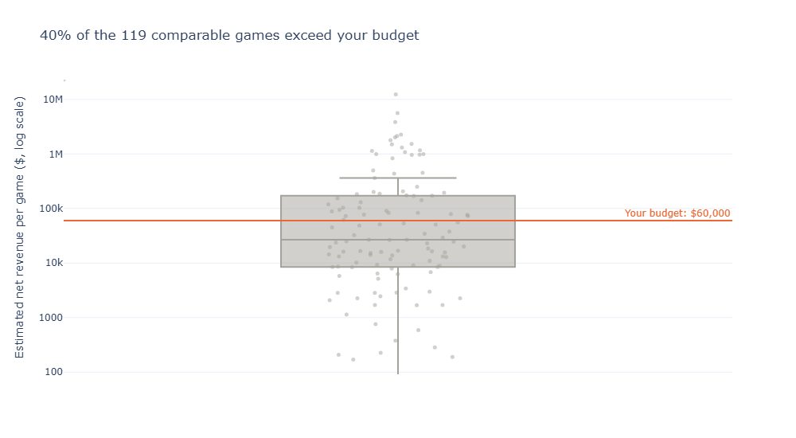

# IndieScope

**IndieScope dit à un studio de jeux indépendant si son jeu a des chances de rembourser son budget sur Steam**, à partir des résultats de plus de 70 000 jeux comparables.



<!-- Capture de l'appli : lancer python app.py, faire une capture de l'onglet Simulateur,
     l'enregistrer dans docs/images/app_simulateur.png, puis remplacer l'image ci-dessus par :
      -->

## Le problème

Plus de 20 000 jeux sortent chaque année sur Steam, et plus de la moitié reçoivent moins de 10 avis.
Un développeur indépendant veut savoir, **avant** de dépenser son budget, si un jeu avec ses tags et son prix a des chances d'être rentable.
IndieScope répond avec une fourchette de revenu, une probabilité de rembourser le budget, un verdict **GO / RISKY / NO-GO** et un prix conseillé.

## Installation

1. Cloner le repo :
   ```
   git clone <url-du-repo>
   cd indiescope
   ```
2. Installer les bibliothèques (Python 3.10 ou plus) :
   ```
   pip install -r requirements.txt
   ```
3. Télécharger `games.csv` depuis Kaggle : [Steam Games Dataset (FronkonGames)](https://www.kaggle.com/datasets/fronkongames/steam-games-dataset), et le placer dans `data/games.csv`.
4. (Optionnel, bonus IA) Copier `.env.example` en `.env` et y mettre une clé `ANTHROPIC_API_KEY`.

## Utilisation

Depuis la racine du projet :

```
python src/cleaning.py      # crée data/games_clean.csv (environ 30 secondes)
python app.py               # lance l'appli sur http://127.0.0.1:7860
```

L'appli a 3 onglets :
- **Simulateur** : cocher les tags, entrer le prix et le budget, cliquer sur « Évaluer » ;
- **Carte du marché** : toutes les niches (tags), et les niches prometteuses ;
- **Méthode** : d'où viennent les chiffres, et leurs limites.

## Arborescence

```
├── app.py                    Interface Gradio (3 onglets)
├── requirements.txt          Bibliothèques à installer
├── .env.example              Modèle du fichier de clé API (bonus IA)
├── data/                     Données (non publiées sur GitHub)
│   ├── games.csv             Fichier brut Kaggle (à télécharger)
│   └── games_clean.csv       Fichier propre, créé par src/cleaning.py
├── src/
│   ├── data_loader.py        Chargement de games.csv (corrige le décalage de colonnes)
│   ├── cleaning.py           Nettoyage + rapport de qualité -> games_clean.csv
│   ├── estimation.py         Ventes et revenu net estimés (3 scénarios)
│   ├── analysis.py           Niches, jeux comparables, revenu par tranche de prix
│   ├── simulator.py          Classe GameConcept : probabilité et verdict GO / RISKY / NO-GO
│   ├── charts.py             Les 4 graphiques Plotly
│   └── assistant.py          Bonus : avis rédigé par une IA (mirascope)
├── notebooks/
│   ├── 01_exploration.ipynb  Ce que contient le dataset
│   ├── 02_cleaning.ipynb     Nettoyage et rapport de qualité
│   ├── 03_estimation.ipynb   Estimation des ventes et validation de la méthode
│   ├── 04_analysis.ipynb     Niches, comparables, prix
│   ├── 05_simulator.ipynb    Le simulateur sur le fil rouge
│   └── 06_charts.ipynb       Les graphiques
├── tests/
│   └── test_project.py       Tests automatiques (11 tests)
└── docs/
    ├── cadrage.md            User story, contrat de données, hypothèses, limites
    ├── guide_indiescope.md   Guide de réalisation du projet
    └── images/               Graphiques exportés
```

## Contrat de données (`data/games_clean.csv`)

Une ligne par jeu payant, tagué, sorti entre 2015 et août 2025 (71 352 jeux).

| Colonne | Type | Signification |
|---|---|---|
| `app_id` | int | Identifiant Steam unique |
| `name` | str | Nom du jeu |
| `release_date` | date | Date de sortie |
| `release_year` | int | Année de sortie (2015 ou après) |
| `price` | float | Prix plein en dollars (> 0), hors promotion |
| `positive` | int | Nombre d'avis positifs |
| `negative` | int | Nombre d'avis négatifs |
| `owners_min` | int | Borne basse des owners SteamSpy |
| `owners_max` | int | Borne haute des owners SteamSpy |
| `tags` | str | Tags séparés par une virgule, sans espace |

Deux pièges du fichier brut sont corrigés :
- l'en-tête a 39 noms pour 40 valeurs (`DiscountDLC count`), ce qui décale toutes les colonnes ;
- `Price` est le prix **soldé** du jour de la collecte. On retrouve le prix plein avec `prix / (1 - remise / 100)`.

## Méthode et hypothèses

Steam ne publie pas les ventes : on les estime à partir du nombre d'avis.

**Revenu net = avis × ventes par avis × prix × (1 − remboursements) × prix moyen payé × (1 − part de Steam)**

| Hypothèse | Valeur | Source / justification |
|---|---|---|
| Ventes par avis (méthode Boxleiter) | 20 / 40 / 60 | Règle empirique de l'industrie, validée ci-dessous |
| Part de Steam | 30 % | Commission standard de Steam |
| Remboursements | 10 % | Ordre de grandeur (remboursement si < 2 h de jeu, < 14 jours) |
| Prix moyen payé | 75 % du prix plein | Une grande partie des ventes se fait en soldes |
| Jeux comparables | Tous les tags du concept, prix ± 50 %, sortis depuis 2020 | Un marché proche du concept et récent |
| Verdict | GO ≥ 50 %, RISKY ≥ 25 %, sinon NO-GO | GO = au moins 1 jeu comparable sur 2 a remboursé ce budget |

**Validation** (`notebooks/03_estimation.ipynb`) :
- notre estimation tombe dans la fourchette d'owners SteamSpy pour 14 % des jeux, et en dessous pour 83 %. Elle est donc prudente ;
- pour 3 jeux aux ventes officielles, le chiffre officiel tombe entre nos scénarios bas et moyen :
  - [Valheim](https://www.pcgamer.com/valheim-has-sold-over-10-million-copies) ;
  - [Balatro](https://www.gematsu.com/2025/01/balatro-sales-top-five-million) ;
  - [Hollow Knight](https://www.avclub.com/hollow-knight-hits-all-time-peak-player-count-sells-15-million-copies).

On utilise la **médiane**, pas la moyenne. Pour le tag Indie, le revenu moyen est de 278 000 $ et le revenu médian de 1 509 $ : quelques gros succès écrasent la moyenne.

## Limites

- L'outil ne voit ni le marketing ni la qualité du jeu.
- Les owners SteamSpy ne sont pas des ventes (clés offertes, bundles, week-ends gratuits).
- Le ratio avis / ventes varie selon le genre et la taille du jeu.
- Biais du survivant : les jeux retirés de Steam ne sont pas dans les données, donc les probabilités sont un peu optimistes.
- Prix et revenu sont corrélés, mais un prix plus haut ne cause pas à lui seul un meilleur revenu (les jeux chers ont souvent plus de budget).
- Les jeux free-to-play sont exclus.
- Le dataset est une photo prise en mars 2026.

## Tests

Depuis la racine du projet :

```
python tests/test_project.py
```

11 fonctions de test vérifient le nettoyage, l'estimation, les comparables, le prix conseillé, la probabilité, le verdict et les cas limites. Elles tournent sur un mini dataset inventé dont les résultats sont calculés à la main. La commande doit afficher « Tous les tests passent ».

## Source des données

[Steam Games Dataset](https://www.kaggle.com/datasets/fronkongames/steam-games-dataset), FronkonGames, Kaggle, licence MIT.
