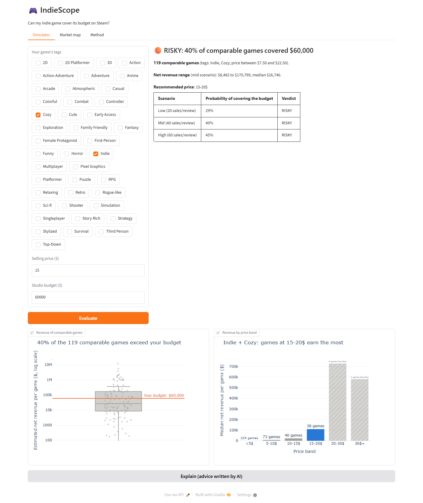

# IndieScope

**IndieScope tells an independent game studio whether its game is likely to cover its budget on Steam**, based on the results of more than 70,000 comparable games.



## The problem

More than 20,000 games are released on Steam every year, and more than half of them get fewer than 10 reviews.
An independent developer wants to know, **before** spending the budget, whether a game with these tags and this price is likely to be profitable.
IndieScope answers with a revenue range, a probability of covering the budget, a **GO / RISKY / NO-GO** verdict and a recommended price.

## Installation

1. Clone the repository:
   ```
   git clone https://github.com/jeevananoop/indiescope.git
   cd indiescope
   ```
2. Install the libraries (Python 3.10 or later):
   ```
   pip install -r requirements.txt
   ```
3. Download `games.csv` from Kaggle: [Steam Games Dataset (FronkonGames)](https://www.kaggle.com/datasets/fronkongames/steam-games-dataset), and put it in `data/games.csv`.
4. (Optional, AI bonus) Copy `.env.example` to `.env` and put an `ANTHROPIC_API_KEY` in it.

## Usage

From the project root:

```
python src/cleaning.py      # creates data/games_clean.csv (about 30 seconds)
python app.py               # starts the app on http://127.0.0.1:7860
```

The app has 3 tabs:
- **Simulator**: tick the tags, enter the price and the budget, click "Evaluate";
- **Market map**: all the niches (tags), and the promising ones;
- **Method**: where the figures come from, and their limits.

## Project structure

```
├── app.py                    Gradio interface (3 tabs)
├── requirements.txt          Libraries to install
├── .env.example              Template of the API key file (AI bonus)
├── data/                     Data (not published on GitHub)
│   ├── games.csv             Raw Kaggle file (to download)
│   └── games_clean.csv       Clean file, created by src/cleaning.py
├── src/
│   ├── data_loader.py        Loads games.csv (fixes the column shift)
│   ├── cleaning.py           Cleaning + quality report -> games_clean.csv
│   ├── estimation.py         Estimated sales and net revenue (3 scenarios)
│   ├── analysis.py           Niches, comparable games, revenue by price band
│   ├── simulator.py          GameConcept class: probability and GO / RISKY / NO-GO verdict
│   ├── charts.py             The 4 Plotly charts
│   └── assistant.py          Bonus: advice written by an AI (mirascope)
├── notebooks/
│   ├── 01_exploration.ipynb  What the dataset contains
│   ├── 02_cleaning.ipynb     Cleaning and quality report
│   ├── 03_estimation.ipynb   Sales estimation and validation of the method
│   ├── 04_analysis.ipynb     Niches, comparable games, prices
│   ├── 05_simulator.ipynb    The simulator on the running example
│   └── 06_charts.ipynb       The charts
├── tests/
│   └── test_project.py       Automated tests (14 tests)
└── docs/
    ├── cadrage.md            Project framing: user story, data contract, assumptions, limitations
    └── images/               Exported charts and app screenshot
```

## Data contract (`data/games_clean.csv`)

One row per paid, tagged game released between 2015 and August 2025 (71,352 games).

| Column | Type | Meaning |
|---|---|---|
| `app_id` | int | Unique Steam identifier |
| `name` | str | Game name |
| `release_date` | date | Release date |
| `release_year` | int | Release year (2015 or later) |
| `price` | float | Full price in dollars (> 0), excluding discounts |
| `positive` | int | Number of positive reviews |
| `negative` | int | Number of negative reviews |
| `owners_min` | int | Lower bound of SteamSpy owners |
| `owners_max` | int | Upper bound of SteamSpy owners |
| `tags` | str | Tags separated by a comma, without spaces |

Two traps of the raw file are fixed:
- the header has 39 names for 40 values (`DiscountDLC count`), which shifts every column;
- `Price` is the **discounted** price on the day of collection. The full price is recovered with `price / (1 - discount / 100)`.

## Method and assumptions

Steam does not publish sales: we estimate them from the number of reviews.

**Net revenue = reviews × sales per review × price × (1 − refunds) × average price paid × (1 − Steam's share)**

| Assumption | Value | Source / justification |
|---|---|---|
| Sales per review (Boxleiter method) | 20 / 40 / 60 | Industry rule of thumb, validated below |
| Steam's share | 30 % | Standard Steam commission |
| Refunds | 10 % | Order of magnitude (refund if < 2 h of play, < 14 days) |
| Average price paid | 75 % of the full price | A large share of sales happens during Steam sales |
| Comparable games | All the concept's tags, price ± 50 %, released since 2020 | A market close to the concept, and recent |
| Verdict | GO ≥ 50 %, RISKY ≥ 25 %, otherwise NO-GO | GO = at least 1 comparable game in 2 covered this budget |

**Validation** (`notebooks/03_estimation.ipynb`):
- our estimate falls inside the SteamSpy owners range for 14 % of games, and below it for 83 %. It is therefore prudent;
- for 3 games with official sales figures, the official figure falls between our low and mid scenarios:
  - [Valheim](https://www.pcgamer.com/valheim-has-sold-over-10-million-copies);
  - [Balatro](https://www.gematsu.com/2025/01/balatro-sales-top-five-million);
  - [Hollow Knight](https://www.avclub.com/hollow-knight-hits-all-time-peak-player-count-sells-15-million-copies).

We use the **median**, not the mean. For the Indie tag, the mean revenue is $278,000 and the median revenue $1,509: a few big hits crush the mean.

## Limitations

- The tool sees neither marketing nor game quality.
- SteamSpy owners are not sales (gifted keys, bundles, free weekends).
- The reviews / sales ratio varies by genre and by game size.
- Survivorship bias: games removed from Steam are not in the data, so the probabilities are slightly optimistic.
- Price and revenue are correlated, but a higher price does not cause a better revenue on its own (expensive games often have bigger budgets).
- Free-to-play games are excluded.
- The dataset is a snapshot taken in March 2026.

## Tests

From the project root:

```
python tests/test_project.py
```

14 test functions check the cleaning (helper functions and the full pipeline), the estimation, the niches, the comparable games, the recommended price, the probability, the verdict and the edge cases. They run on a small made-up dataset whose results are computed by hand. The command must print "All tests pass".

## Data source

[Steam Games Dataset](https://www.kaggle.com/datasets/fronkongames/steam-games-dataset), FronkonGames, Kaggle, MIT licence.

## Team

- **Jeevan**: sales and revenue estimation, price analysis, go / no-go simulator.
- **Guillaume**: data collection and cleaning, niche comparison, refactoring and tests.
